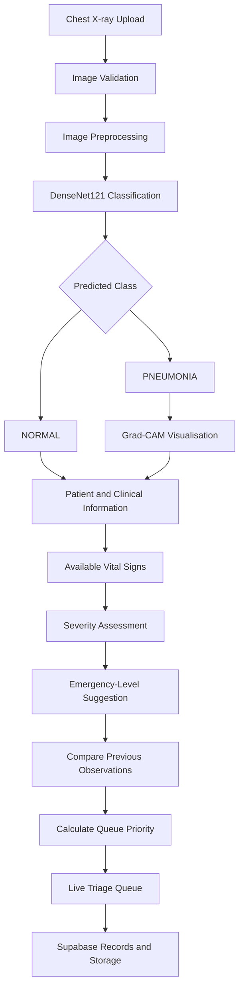
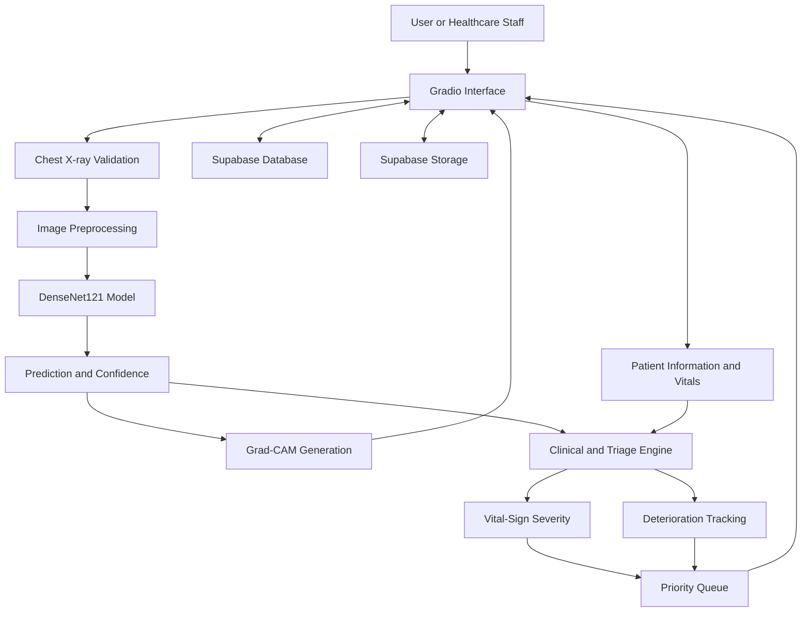

# ChestScan 🫁
### AI-Powered Chest X-Ray Analysis and Emergency Triage Support System

**From medical image analysis to patient-aware clinical decision support.**

ChestScan is an AI-powered healthcare support application designed to analyse chest X-ray images for pneumonia detection and help healthcare teams organise patient prioritisation using available clinical information.

Built around **DenseNet121, Grad-CAM explainability, vital-sign analysis, patient history and deterioration tracking**, ChestScan goes beyond standalone image classification by connecting AI-generated imaging results with a broader patient-monitoring and triage workflow.

The system combines medical image analysis with clinical context to support more structured patient assessment and prioritisation, while keeping healthcare professionals in control of all clinical decisions.

> **Project status:** AI-powered chest X-ray analysis and triage-support prototype. Digital-twin capabilities and live medical-device integrations are potential future extensions, not claims of completed functionality.

---

## 📌 Table of Contents

- Overview
- Problem Statement
- Our Approach
- Key Features
- System Workflow
- System Architecture
- AI Pipeline
- Patient Monitoring and Triage
- Technology Stack
- Data Storage
- Project Structure
- Getting Started
- Responsible AI and Clinical Safety
- Current Limitations
- Future Scope
- Conclusion

---

## 🩺 Overview

Chest X-rays are widely used to investigate respiratory conditions, including pneumonia. However, reviewing an image is only one part of patient assessment. Healthcare teams may also need to consider vital signs, previous observations, changes in clinical condition and the time a patient has been waiting for attention.

ChestScan brings these elements together in a unified application.

The system uses a trained **DenseNet121 deep learning model** to classify chest X-ray images into two categories:

- **NORMAL** — the model classifies the image as normal.
- **PNEUMONIA** — the model classifies the image as showing patterns associated with pneumonia.

It also generates Grad-CAM visualisations, stores patient scan records, compares available vital signs across observations and maintains a dynamically ordered triage queue.

ChestScan is intended to support clinical workflows rather than replace medical expertise.

## 🎯 Problem Statement

Standalone medical image classifiers typically return a predicted class and a confidence score. Although useful, this information alone does not represent a patient's overall clinical condition.

A patient with a high-confidence pneumonia prediction is not necessarily in a more critical condition than every other patient. Similarly, a single observation may not reveal whether a patient's condition is improving or deteriorating.

ChestScan addresses this workflow gap through four complementary capabilities:

1. **Image intelligence:** Analyse chest X-rays using deep learning.
2. **Explainability:** Visualise image regions that contribute to the model's prediction.
3. **Patient context:** Consider available vital signs, previous observations and clinical history.
4. **Triage organisation:** Arrange waiting patients using a defined priority hierarchy and waiting time.

The goal is to connect imaging results with patient-level information in one accessible application.

## 💡 Our Approach

ChestScan follows a modular architecture that combines computer vision, deep learning, clinical information processing and persistent storage.

Rather than treating every X-ray as an isolated prediction, the application associates scan results with patient records and available clinical observations.

The resulting workflow supports:

- Chest X-ray validation before classification.
- Pneumonia classification using DenseNet121.
- Grad-CAM-based visual explanation.
- Vital-sign-based severity assessment.
- Comparison of current and previous observations.
- Emergency-level suggestions and a prioritised waiting queue.
- Persistent scan history for reviewing previous assessments.

## ✨ Key Features

### 1. AI-Powered Pneumonia Detection

ChestScan uses a trained DenseNet121 model to analyse chest X-ray images.

The model produces a prediction for the NORMAL or PNEUMONIA class, together with the associated class probabilities or confidence output.

The application handles the supported model-output format and presents the result in a readable form.

**Why it matters:** It provides an AI-assisted first-pass analysis of chest X-ray images without relying on a manually interpreted output tensor.

### 2. Chest X-Ray Image Validation

Before classification, an image-validation stage checks whether the uploaded image appears to be a clinical chest X-ray.

The validation is designed to reject unsuitable inputs, such as:

- Brain MRI scans.
- X-rays of unrelated body parts.
- Medical illustrations.
- Ordinary photographs.

The application uses a vision model through OpenRouter for this validation step.

This additional check helps reduce inappropriate inputs, although automated validation cannot guarantee that every accepted image is suitable for clinical interpretation.

### 3. Explainable AI with Grad-CAM

A classification result alone does not show which image regions influenced the model's decision.

ChestScan uses **Gradient-weighted Class Activation Mapping (Grad-CAM)** to generate a heatmap associated with the model's prediction.

The application can display:

- The original chest X-ray.
- The Grad-CAM heatmap overlay.
- The hottest activation point.
- An approximate highlighted region.
- An opacity marker for visual reference.

The implementation prefers the DenseNet121 layer `conv5_block16_concat`, with a fallback to a suitable convolutional layer if that layer is unavailable in the loaded model.

**Why it matters:** Grad-CAM offers a visual aid for reviewing model behaviour. It does not establish a confirmed tumour, infection, lesion boundary or disease location, and it should not be treated as a substitute for radiological interpretation.

### 4. Vital-Sign-Based Severity Assessment

ChestScan can incorporate the following measurements when available:

- Peripheral oxygen saturation (SpO₂).
- Respiratory rate.
- Heart rate.

These measurements contribute to the application's severity-assessment logic.

Missing values are not fabricated or automatically treated as normal. The system uses the available information and distinguishes between observed and unavailable measurements.

The severity calculation is a prototype decision-support mechanism and must not be interpreted as a clinically validated scoring system unless independently validated.

### 5. Emergency Triage Support

The application suggests one of four emergency levels:

- **CRITICAL**
- **HIGH**
- **MODERATE**
- **LOW**

The suggested level considers available clinical information and the application's severity logic.

Importantly, a high-confidence pneumonia prediction does not automatically imply a critical emergency. When vital signs are unavailable, image-model confidence alone is insufficient to justify a CRITICAL recommendation.

Clinical staff can review and modify the suggested level.

These categories support prototype workflow organisation; they are not a substitute for an established, clinically validated triage protocol.

### 6. Patient Deterioration Tracking

For patients with a consistent Patient ID and previous records, ChestScan compares the current vital signs with the most recent previous observation.

The application can label the observed trend as:

- **WORSENING**
- **STABLE**
- **IMPROVING**
- **UNKNOWN**

Only measurements available in both observations are compared.

This feature introduces a longitudinal perspective by considering changes between observations rather than examining each record independently.

The labels describe changes in the selected measurements; they do not constitute a validated forecast of future deterioration.

### 7. Dynamic Patient Priority Queue

ChestScan includes a live triage queue for patients who are still waiting for attention.

The queue follows this priority hierarchy:

1. Emergency level.
2. Available clinical severity indicators.
3. Deterioration trend.
4. Waiting time.
5. Registration timestamp as the final tie-breaker.

Patient names and Patient IDs are not used to determine clinical priority.

When patients have the same emergency level, the application uses the subsequent priority criteria to organise the queue.

Healthcare staff can mark completed patients as discharged from the waiting queue.

### 8. Patient History and Persistent Storage

ChestScan uses Supabase to store patient scan records and associated information.

Depending on the available record, the history can include:

- Patient details.
- Predicted class and confidence.
- NORMAL and PNEUMONIA probabilities.
- Emergency level.
- Available vital signs.
- Deterioration status.
- Priority information.
- Clinical remarks.
- Waiting time.
- Grad-CAM preview.

The original X-ray images and Grad-CAM outputs are stored separately using Supabase Storage.

This provides a centralised way to review previously saved assessments and compare available patient observations.

### 9. Clinical Review and Human Oversight

ChestScan is designed to assist healthcare teams, not make autonomous clinical decisions.

The suggested emergency level can be edited by clinical staff, and model predictions, heatmaps and trend indicators should be reviewed in the appropriate clinical context.

Human oversight is an integral part of the intended workflow.

---

## 🔄 System Workflow

The application follows this sequence:

1. A user uploads a chest X-ray.
2. The image-validation stage checks whether the input appears to be a chest X-ray.
3. The image is preprocessed for the trained DenseNet121 model.
4. The model generates a NORMAL or PNEUMONIA prediction.
5. Grad-CAM generates an explanatory visualisation when supported by the workflow.
6. Available patient information and vital signs are collected.
7. The severity-assessment logic generates a suggested emergency level.
8. Previous observations are compared when matching patient records are available.
9. The triage engine calculates queue priority.
10. The patient assessment and associated information can be saved for future review.

### Workflow Diagram



## 🧠 AI Pipeline

### Image Preprocessing

The input image is converted into RGB format and resized to the dimensions expected by the trained model.

The corresponding DenseNet121 preprocessing function is applied before inference.

Correct preprocessing is important because the model expects input in the format used during training.

### DenseNet121 Classification

DenseNet121 is the convolutional neural network used for binary chest X-ray classification.

The model's output is converted into the application's supported NORMAL and PNEUMONIA probabilities or confidence values.

The predicted class is selected according to the model-output interpretation implemented in the application.

The displayed confidence should not be interpreted as a calibrated probability of disease unless calibration has been evaluated.

### Grad-CAM Explainability

Grad-CAM uses gradients associated with the selected class and convolutional feature maps to generate a spatial heatmap.

The heatmap is overlaid on the original X-ray to make the model's activation pattern easier to inspect.

This helps with qualitative model review, but a highlighted region does not prove that the model has identified the medically correct cause of an abnormality.

## 📊 Patient Monitoring and Triage Logic

ChestScan separates image classification from the suggested emergency level.

These answer different questions:

- **Image classification:** Which of the two trained classes does the image resemble?
- **Severity assessment:** What do the available clinical measurements indicate under the application's implemented rules?
- **Deterioration tracking:** How have selected measurements changed since the previous observation?
- **Queue prioritisation:** In what order should waiting records be presented under the application's priority hierarchy?

The distinction is important because image-model confidence and clinical urgency are not interchangeable.

The system should be evaluated against suitable clinical reference standards before its severity scores or prioritisation decisions are used to guide real patient care.

## 🏗️ System Architecture

ChestScan consists of the following logical components:

**Frontend — Gradio**
- Image upload and result presentation.
- Patient information entry.
- Vital-sign display.
- Patient history and triage queue.

**AI and Computer Vision — Python, TensorFlow, DenseNet121 and OpenCV**
- Image preprocessing.
- Pneumonia classification.
- Grad-CAM generation.
- Supporting image processing.

**Image Validation — OpenRouter Vision Model**
- Checks whether an uploaded image appears to be a clinical chest X-ray before the main classifier processes it.

**Clinical Information Processing**
- Vital-sign-based severity calculation.
- Comparison of available observations.
- Emergency-level suggestion.
- Queue prioritisation.

**Persistence — Supabase**
- Patient scan records.
- Historical assessment information.
- Original X-ray storage.
- Grad-CAM result storage.

### Architecture Diagram



## 🛠️ Technology Stack

| Component | Technology |
|---|---|
| Programming language | Python |
| User interface | Gradio |
| Deep learning framework | TensorFlow |
| Classification model | DenseNet121 |
| Explainable AI | Grad-CAM |
| Image processing | OpenCV, Pillow |
| Image validation | OpenRouter vision model |
| Database and persistence | Supabase |
| Numerical processing | NumPy |
| HTTP requests | Requests |

## 🗄️ Data Storage

ChestScan uses Supabase for persistent records and image storage.

The application is configured to use the following storage buckets:

- `original-xrays` — original uploaded X-ray images.
- `gradcam-results` — generated Grad-CAM visualisations.
- `patient_scans` — associated scan images or records, according to the application's implementation.

Patient records may include identification details, scan predictions, clinical observations, triage information and timestamps.

**Privacy considerations:** Medical images and patient information are sensitive. Use appropriately licensed datasets and synthetic patient records for demonstrations wherever possible. Before using real patient data, implement suitable access controls, data minimisation, secure storage, consent and applicable legal and institutional safeguards. Never publish secrets, API keys or identifiable patient information in a public repository.

## 🚀 Getting Started

### Prerequisites

- Python installed in your development environment.
- Access to the trained DenseNet121 model file.
- Supabase project credentials for database and storage operations.
- An OpenRouter API key if the image-validation feature is enabled.
- Access to the required Python packages.

### 1. Clone the Repository

```bash
git clone <YOUR_GITHUB_REPOSITORY_URL>
cd ChestScan
```

Replace the repository URL and directory name with your actual values.

### 2. Create a Virtual Environment

```bash
python -m venv .venv
```

Activate it on Windows:

```bash
.venv\Scripts\activate
```

On Linux or macOS:

```bash
source .venv/bin/activate
```

### 3. Install Dependencies

If the repository contains a `requirements.txt` file:

```bash
pip install -r requirements.txt
```

Otherwise, install the dependencies specified by your actual application and model environment.

### 4. Configure Environment Variables

Create a local `.env` file or configure environment variables using your deployment platform.

Example configuration:

```env
SUPABASE_URL=your_supabase_project_url
SUPABASE_KEY=your_supabase_key
OPENROUTER_API_KEY=your_openrouter_api_key
MODEL_PATH=path_to_your_trained_model
```

Use the exact variable names expected by your application code. Do not commit real credentials to GitHub.

### 5. Add the Trained Model

Place your trained DenseNet121 model at the configured path.

For example, if your actual model file is named `densenet121.h5`, configure the model path accordingly.

### 6. Launch the Application

Run the Python entry-point file used by your project.

For example, if the entry point is `app.py`:

```bash
python app.py
```

The filename may differ in your repository. Use the actual application entry point.

## ⚠️ Responsible AI and Clinical Safety

ChestScan is a research and prototype clinical decision-support application.

It has important limitations:

- Binary classification does not identify every possible respiratory disease.
- Model predictions may be incorrect or poorly calibrated.
- Grad-CAM visualisations do not establish a medically correct diagnosis.
- Missing vital signs can limit severity assessment.
- Rule-based deterioration labels do not guarantee prediction of future clinical events.
- The triage hierarchy is not a replacement for validated clinical triage protocols.
- Performance on a training or test dataset does not establish generalisation to other hospitals or patient populations.

Before clinical deployment, the system would require appropriate external validation, clinical evaluation, privacy and security assessment, usability testing and review against applicable medical-device and healthcare requirements.

Final diagnosis, treatment and emergency decisions must remain with qualified healthcare professionals.

## 🔬 Current Limitations

The current project focuses on binary chest X-ray classification and workflow support.

It does not, by itself, establish:

- A validated digital twin of lung physiology.
- Live integration with hospital equipment or wearable devices.
- Clinically validated future deterioration prediction.
- Automatic measurement of disease progression from serial images.
- Clinical effectiveness in reducing waiting times or improving patient outcomes.

These are potential directions for future development and should only be described as implemented after the corresponding functionality has been built and evaluated.

## 🚀 Future Scope

### 1. Longitudinal Respiratory Health Monitoring

Develop a patient-specific health profile that updates when new clinical observations or scans become available.

### 2. Digital-Twin-Oriented Architecture

Extend the patient history into a structured, evolving representation of the patient's observed respiratory health, with timestamps, measurement provenance and clearly distinguished missing values.

### 3. Time-Series Analysis

Investigate suitable models for analysing repeated vital-sign measurements and estimating future risk when sufficient, representative, longitudinal data are available.

### 4. Serial Image Comparison

Explore methods for comparing repeated chest X-rays, subject to image quality, acquisition differences and appropriate clinical validation.

### 5. Additional Respiratory Conditions

Investigate multi-class or multi-label models for other chest X-ray findings using suitable datasets and carefully defined evaluation protocols.

### 6. Wearable and Clinical Data Integration

Explore secure integration with supported health-monitoring devices or clinical information systems, subject to data availability, permissions and technical compatibility.

### 7. Model Evaluation and Monitoring

Add detailed performance reports, external validation, calibration assessment, subgroup evaluation and monitoring for changes in model performance.

### 8. Secure Clinical Workflow

Explore role-based access, audit logs, clinician review history and appropriate privacy-preserving data management.

## 🌟 Why ChestScan?

ChestScan brings together several components that are often demonstrated separately in introductory medical AI projects:

- Deep-learning-based image classification.
- Explainable AI visualisation.
- Automated input validation.
- Patient-level clinical context.
- Vital-sign trend comparison.
- Structured triage prioritisation.
- Persistent patient scan history.

Its central idea is to connect image analysis with the surrounding patient-monitoring workflow instead of stopping at a predicted label.

The project provides a foundation for exploring how medical imaging AI can work alongside longitudinal patient information in a more integrated healthcare application.

## 👥 Team

**Project:** ChestScan — AI-Powered Chest X-Ray Analysis and Emergency Triage Support System

**Team members:** Add your team members' names and roles here.

**Institution:** Add your institution name here.

## 📄 Conclusion

ChestScan demonstrates an integrated approach to AI-assisted chest X-ray analysis by combining DenseNet121 pneumonia classification, Grad-CAM visualisation, patient history, available vital signs, deterioration tracking and triage queue management.

Its focus is not merely to predict a class, but to connect the prediction with patient-level information that can help organise clinical review.

With further development of longitudinal patient modelling, data integration and clinical validation, ChestScan could provide a foundation for exploring a respiratory-health digital twin. Such an extension would require additional implementation and evidence beyond the current prototype.

**Disclaimer:** ChestScan is a research prototype, not a certified medical device. It is not intended to diagnose, treat or independently triage patients. All outputs require appropriate clinical review.
